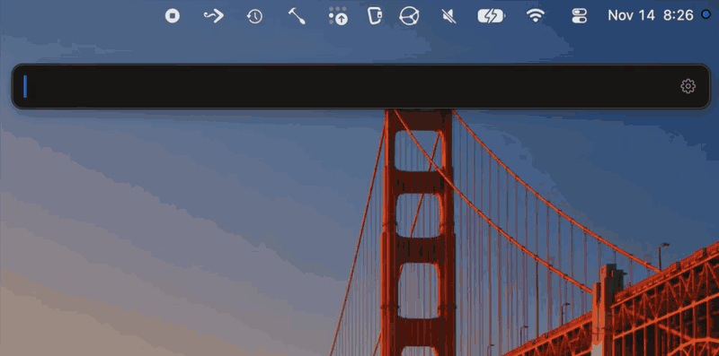
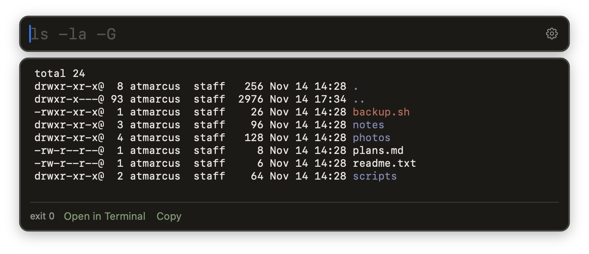
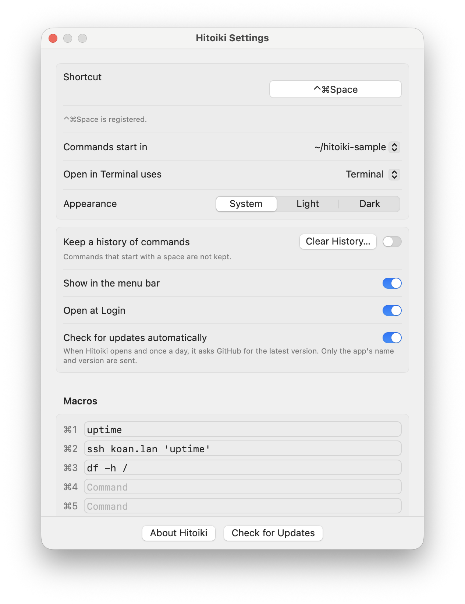

# Hitoiki 一息


A command runner for Mac. · [hitoiki.sageframe.net](https://hitoiki.sageframe.net)

Hitoiki runs a shell command from a floating panel. Press a shortcut, type a command, see the output, and dismiss the panel. Commands run locally or over SSH with your own shell, configuration and keys, and there is no terminal window to manage. The name, 一息 (*hitoiki*), means "one breath" in Japanese. The early documents in `ho-process/` use the project's first name, Issoku.

<p align="center">
  <br>
  <em>Summon the panel, run a command, read the result.</em>
</p>

<p align="center">
  <br>
  <em>Colour output and the exit status. The command stays in grey.</em>
</p>

## Using Hitoiki

Press `Control-Command-Space` to show the panel. Type a command and press Return. The output appears under the input as the command runs, followed by its exit status. The command you ran stays in the input in grey after it runs. You can change the shortcut in settings. If another app or macOS already holds the shortcut, Hitoiki says so in the panel and in settings. If the shortcut does not work, open Hitoiki again from Applications to show the panel.

```sh
git -C ~/code/project status
ssh homelab uptime
ssh homelab 'systemctl status caddy'
```

- **Settings.** Press `Command-comma`, or click the gear in the panel.
- **Escape** takes one step at a time. It stops a running command. Then it clears the panel. On an empty panel it hides the panel. A click outside the panel hides it and keeps what is on it, but never while a command runs.
- **Working directory.** Commands start in your home folder, or in a fixed folder you choose in settings.
- **Macros.** Settings holds nine macros. `Command-1` to `Command-9` put a macro's text in the input. Nothing runs until you press Return.
- **History.** History is off by default. When you turn it on, Hitoiki keeps the commands you run in `~/Library/Application Support/Hitoiki/history.txt`, one per line. A line that starts with a space is kept nowhere; in a command of several lines, each line is kept or left on its own. Down-arrow shows past commands, and Right-arrow takes the grey suggestion after the cursor. Clear History in settings deletes the file.
- **Copy.** `Command-C` or the Copy button copies the selected output, or all of it when nothing is selected.
- **Open in Terminal.** After a command ends, this button opens a new terminal window in the folder the command ran in. It does not run the command again. Terminal.app is the default. Settings can choose Ghostty, iTerm2, Kitty, WezTerm or Alacritty when installed, or another terminal.
- **Open at Login.** A switch in settings, off by default. macOS keeps this setting, so it also shows in System Settings › General › Login Items.
- **Menu bar item.** Off by default; turn it on in settings. Its menu has Show Hitoiki, About Hitoiki, Check for Updates…, Settings… and Quit.

<p align="center">
  <br>
  <em>Settings: the shortcut, the working directory, history, macros and the update check.</em>
</p>

## Behaviour and limits

- **Stop.** Stop or `Control-C` interrupts the command. A second Stop or `Control-C` ends it by force. Quitting Hitoiki ends any command that is still running.
- **Typing while a command runs.** Your keys go to the command, so you can answer a prompt. Hitoiki shows only what the command sends back, so a password prompt that hides your typing shows no password.
- **Your shell environment.** Hitoiki reads your login shell's environment once, when it opens. If you change your shell setup, quit Hitoiki and open it again.
- **Non-interactive shell.** Commands run in a non-interactive shell, so aliases and shell functions are not available.
- **The `-tt` retry.** If sudo on a remote host says it needs a terminal to read the password, Hitoiki offers to run the same `ssh` command again with `-tt`, which asks for a remote terminal. Press Return or click Retry. The retry runs the entire remote command again, including anything in it that may already have succeeded. The panel shows the command before it runs. You can also type `-tt` yourself, as in `ssh -tt homelab 'sudo systemctl restart caddy'`.
- **What needs a terminal.** Hitoiki shows colour, bold text and progress bars that redraw a line. It is not a terminal emulator. Use a terminal for full-screen programs such as `vim`, `htop` and `tmux`, and for sessions that stay open.
- **Long unbroken lines.** One line over 1 MiB with no line feed streams slowly while it runs. Lines that end stream at full speed.

## Installation

Hitoiki needs macOS 14 or later. There are two ways to get it.

**Get the app.** Buy the signed, notarised app at [hitoiki.sageframe.net](https://hitoiki.sageframe.net). It is the same code as this repository, built and ready to install; what you pay for is that convenience.

**Build it yourself.** Free, under the MIT license. `ARCH_FLAGS="" ./scripts/build_macos.sh` builds `dist/Hitoiki.app` for your Mac. See [Development](#development).

## Removing Hitoiki

Hitoiki keeps data in two places:

- the settings file, `~/Library/Preferences/com.sageframe.hitoiki.plist`
- with history on, the folder `~/Library/Application Support/Hitoiki/`

If you turned on Open at Login, turn it off first. Then quit Hitoiki, delete it from Applications, and delete those two.

## Privacy

When Hitoiki opens, and once a day while it runs, it asks GitHub for the latest version number. It sends only its name and version, and nothing about you or your commands. GitHub sees your internet address, as any website does. You can turn the check off in settings. If a newer version exists, a line in the panel links to the project's site.

Hitoiki has no telemetry and no account. Output stays in memory and is never saved. Commands you run can make their own network requests.

## Development

Hitoiki is Swift 6, built with Swift Package Manager, with no dependencies.

- The tests run in a macOS guest under Tart, through `scripts/vm-test.sh`, because some tests open windows. The script runs the formatter, the linter, the build, the tests and the coverage floor.
- [`RELEASING.md`](RELEASING.md) gives the release steps.
- [`TECHNICAL.md`](TECHNICAL.md) describes how Hitoiki works.

Hitoiki is one of a set of native Mac apps, with [pālana](https://github.com/sageframe-no-kaji/palana), a file manager for the homelab, and [Sharibako](https://github.com/sageframe-no-kaji/sharibako), a vault for API keys.

## License

[MIT](LICENSE).

---

Andrew Todd Marcus — [atmarcus.net](https://atmarcus.net) · [sageframe.net](https://sageframe.net). Lovingly made by hand, in collaboration with AI, using the [Ho process](https://hosystem.sageframe.net/). Last meaningful update: 2026-11-14.
